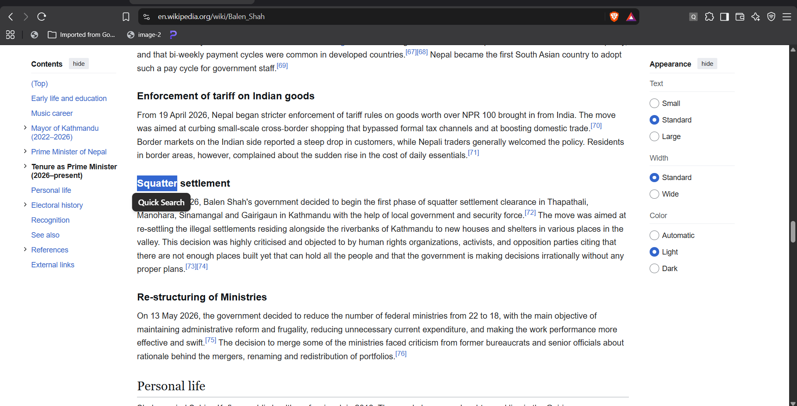
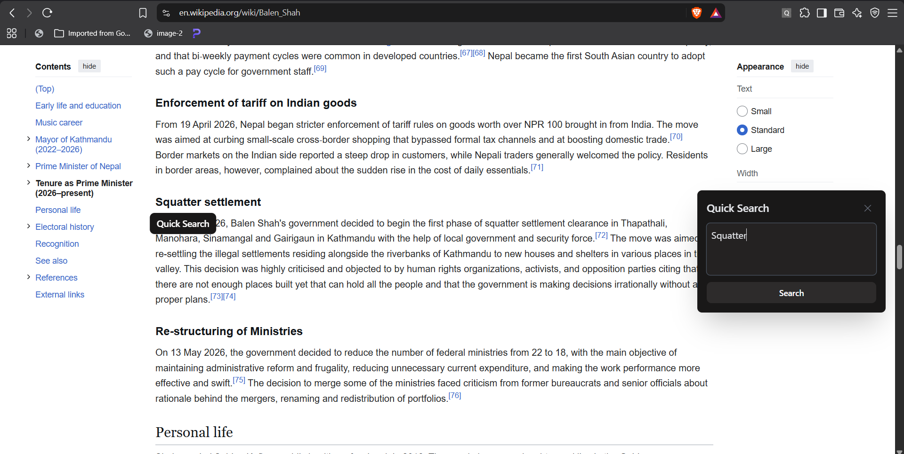
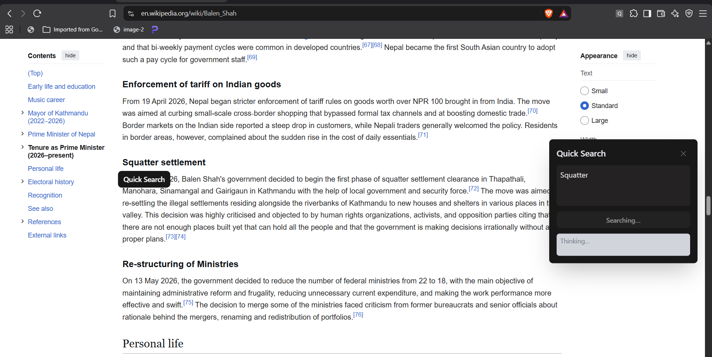
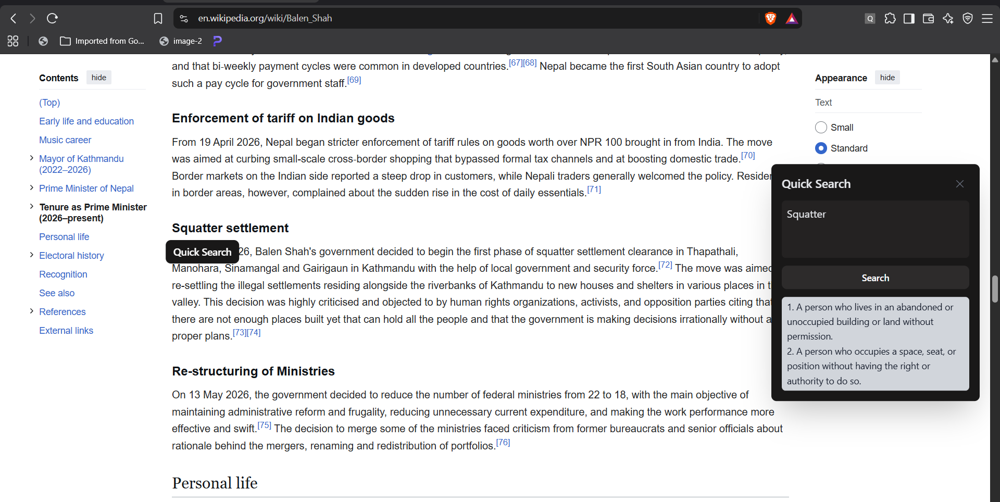
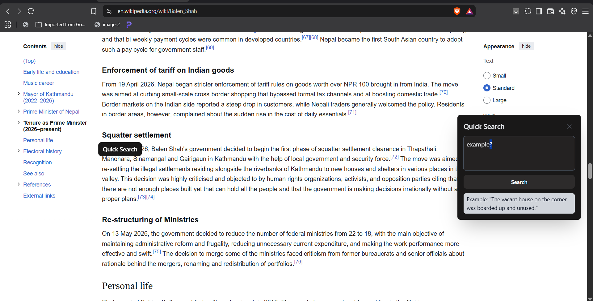
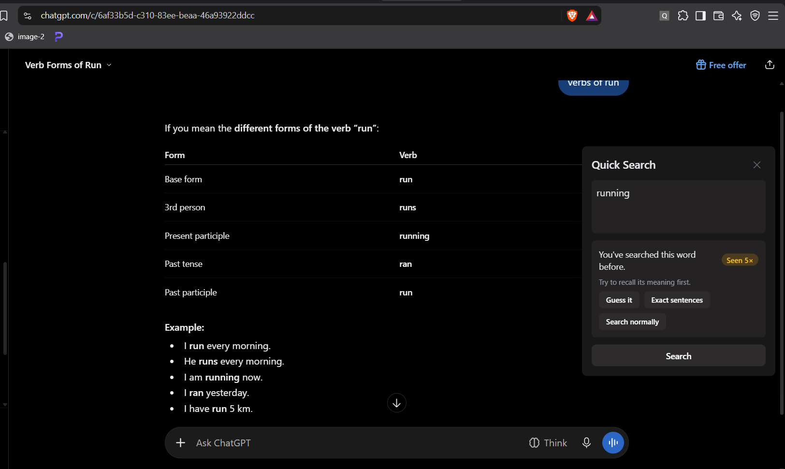
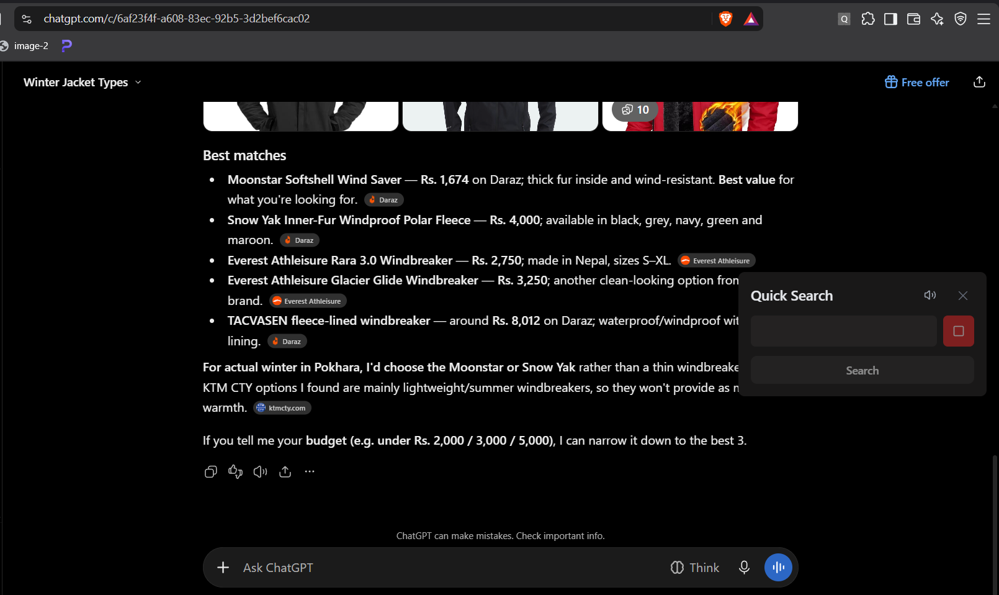
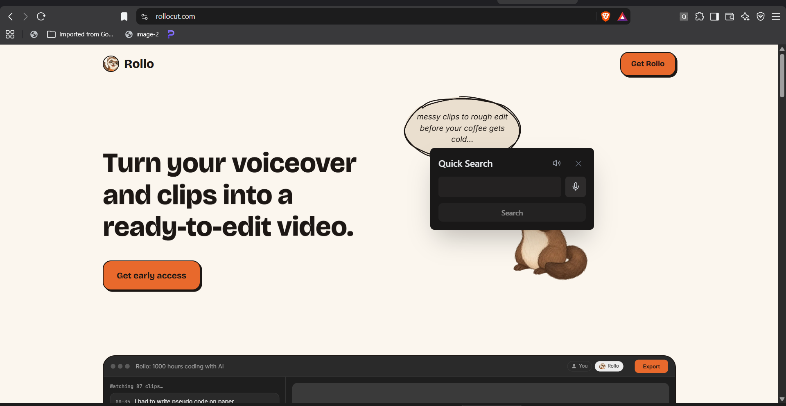

# Quick Search Extension

Hey, have you ever experienced this?

You're reading something, come across a word or phrase you don't understand, and then you have to switch to Google, an LLM, a dictionary, or open a new tab just to figure it out.

Honestly, I find that pretty frustrating.

So, I built a browser extension to make that process a little easier.

## How does it help?

- Confused by a word or phrase? **Just select it and do a quick search.**
- Want to understand it better? **Ask follow-up questions right there.**
- Need an example? **Ask for one without leaving the page.**
- See the same word again? **Instead of looking it up repeatedly, try recalling its meaning from memory.**
- Need a quick reminder? **Recall the word using the exact sentence where you first saw it or its simple meaning.**
- I need pronunciation? **Okay**
- I want to search but I do not like to type? **Okay, you can speak?**
- I want to move the search card? **Okay, you can drag anywhere you want. And double tap on *Quick Search* to reset the position**

The idea is not just to help you **look up words**, but also to help you **remember them**.

Instead of re-reading the same word and meaning again and again, you can practice recalling it when you encounter it again.

## Short cut key.
- What if i can not select the text or content? **Just press *Alt+Shift+S* then search.**

Some pics: 

